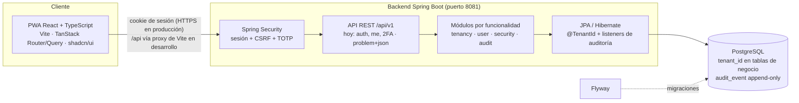
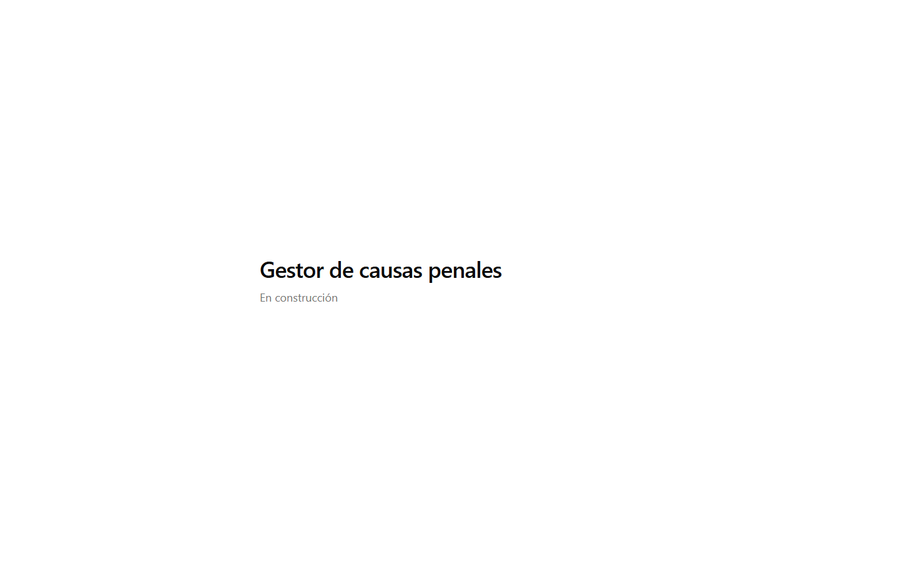

# Gestor de causas penales

[](https://github.com/francopalavecino2002/Gestor-causas-penales/actions/workflows/ci.yml)

Gestor de causas penales para estudios jurídicos chicos (1 a 5 abogados), pensado para el
**proceso penal acusatorio de Neuquén** (CPP, Ley 2784).

> **Estado:** en construcción. Los cimientos (multi-estudio, autenticación, 2FA, auditoría) están
> terminados; el dominio (legajos, audiencias, plazos) y la interfaz vienen después. Ver el
> [ROADMAP](ROADMAP.md). Todos los datos del repositorio son **ficticios**.

## El producto

En el sistema acusatorio el trabajo de la defensa gira alrededor de las **audiencias**, no del
expediente en papel. Por eso la pantalla principal es la agenda: qué audiencias hay hoy y esta
semana, de qué legajo, en qué sala y quién del estudio va.

### Ya construido

- **Seguridad desde el día uno:** cada estudio ve solo sus datos (multi-tenant), usuarios con roles
  (titular, abogado, procurador, administrativo), login con sesión y CSRF, límite de intentos,
  segundo factor con TOTP y códigos de recuperación.
- **Historial de cambios inalterable** (quién, cuándo, qué campo, valor anterior y nuevo) y
  **nada se borra: se archiva**. Los antecedentes penales son datos sensibles (Ley 25.326, art. 7).
- **Datos de demo ficticios** para probarlo sin cargar nada real.
- **Esqueleto de PWA** instalable, con manifiesto en español.

### Planificado

- **Agenda de audiencias como eje:** hoy, semana, por abogado, mobile-first (desde 360 px), para
  mirarla desde el celular en los pasillos de la OFIJU.
- **Legajos, personas y plazos:** imputados con sus cargos y situación de libertad, equipo asignado,
  plazos calculados con su fuente legal y un aviso claro: el sistema asiste, el abogado controla.
- **Configurable sin código:** campos propios, catálogos, plantillas por tipo de causa y reglas de
  plazos por estudio. Una jurisdicción es un paquete de configuración: Neuquén viene de fábrica y
  otras provincias se agregan sin programar.

## Arquitectura



- **Monorepo:** `backend/` (Java), `frontend/` (React), `docs/` (decisiones, dominio, capturas),
  `scripts/` y `.github/` (CI).
- **Backend organizado por funcionalidad** (`tenancy`, `user`, `security`, `audit`, `demo`), no por
  capa técnica. DTOs en el borde, Bean Validation y errores `application/problem+json`.
- **Multi-estudio (multi-tenant) en un esquema compartido:** todas las tablas de negocio tienen
  `tenant_id`, y Hibernate agrega el filtro a cada consulta con `@TenantId`. Sin estudio resuelto, la
  consulta no devuelve nada (falla cerrada). Hay tests que prueban que el estudio A no lee datos del B.
- **Auditoría:** listeners de Hibernate escriben en una tabla `audit_event` que triggers de
  PostgreSQL protegen contra `UPDATE`, `DELETE` y `TRUNCATE`. Borrar entidades está prohibido; se
  archivan con `archived_at`.

## Stack

| Capa | Tecnologías |
|------|-------------|
| Backend | Java 21, Spring Boot 4.2, Spring Security, Spring Data JPA (Hibernate 7), Flyway, PostgreSQL 18, Lombok, Maven |
| Frontend | React 19, TypeScript, Vite 8, Tailwind CSS v4, shadcn/ui, TanStack Router y Query, vite-plugin-pwa |
| Tests | JUnit + Testcontainers (PostgreSQL real, sin mocks de la base), Vitest + Testing Library, Playwright |
| Infra | Docker Compose para Postgres local, GitHub Actions |

## Cómo correrlo localmente

### Demo en un comando

Con Docker Desktop abierto, JDK 21+ y Node 22.12+:

```bash
powershell -ExecutionPolicy Bypass -File scripts\demo.ps1   # Windows
bash scripts/demo.sh                                         # Linux, macOS o Git Bash
```

Levanta Postgres, el backend con datos ficticios de hoy (base `gestor_demo`, recreada en cada
corrida) y el frontend; abre el navegador e imprime los usuarios y la clave. También publica la app
en la IP de la red local para abrirla desde un celular en el mismo Wi-Fi (`--local` / `-Local` lo
desactiva). Detalles, usuarios y problemas comunes en [`docs/DEMO.md`](docs/DEMO.md).

### Paso a paso

Requisitos: JDK 21 o superior, Node 22.12 o superior, Docker con Docker Compose. Los comandos son
de bash (Linux, macOS o Git Bash). Si `./mvnw` falla en Git Bash por falta de `mktemp`, usá `mvn`
(Maven 3.10) con los mismos argumentos.

```bash
# 1. Opcional: .env solo lo lee Docker Compose; el perfil "dev" del backend ya usa los mismos
#    valores por defecto. Si cambiás DB_* acá, exportalos también para el backend.
cp .env.example .env

# 2. PostgreSQL en localhost:5434
docker compose up -d

# 3. Backend en http://localhost:8081
#    El perfil "demo" crea un estudio ficticio (slug "estudio-demo") con tres usuarios.
cd backend
DEMO_PASSWORD='elegí-una-clave-de-12+' ./mvnw spring-boot:run -Dspring-boot.run.profiles=dev,demo

# 4. Frontend en http://localhost:5173 (en otra terminal; /api se redirige al backend)
cd frontend
npm ci
npm run dev
```

Los usuarios de demo tienen correos `@example.com`; los nombres están en
[`DemoData.java`](backend/src/main/java/ar/gestorpenal/demo/DemoData.java). Usá Chrome o Firefox:
la cookie de sesión es `Secure` y Safari no la acepta en `http://localhost`
([ADR-0008](docs/DECISIONS.md#adr-0008-authentication-with-a-server-session-csrf-and-per-firm-users-t05)).

### Tests

```bash
# Backend: unitarios + integración con Testcontainers (necesita Docker)
cd backend && ./mvnw -B verify

# Frontend: lint, tipos, tests unitarios, build y smoke test de Playwright
cd frontend && npm run lint && npm run typecheck && npm test -- --run && npm run build
npx playwright install chromium && npm run test:e2e   # levanta su propio build + preview en 4173
```

Los puertos 5432, 5433 y 8080 quedan libres a propósito: Postgres usa 5434, el backend 8081 y el
frontend 5173.

## Decisiones técnicas

Cada decisión importante tiene un ADR en [docs/DECISIONS.md](docs/DECISIONS.md). Las principales:

| Decisión | Por qué | ADR |
|----------|---------|-----|
| Multi-tenancy con `@TenantId` de Hibernate en esquema compartido | No se puede olvidar el filtro (cubre `findById`) y falla cerrado; RLS de PostgreSQL queda como defensa adicional futura | [0007](docs/DECISIONS.md#adr-0007-multi-tenancy-with-hibernate-tenantid-t04) |
| Sesión de servidor con CSRF, no JWT | Las sesiones se pueden revocar (un celular robado, un procurador que se va) | [0008](docs/DECISIONS.md#adr-0008-authentication-with-a-server-session-csrf-and-per-firm-users-t05) |
| TOTP propio sobre el JDK, secretos cifrados con AES-256-GCM | Funciona con cualquier app autenticadora, sin SMS ni servicios externos; probado con los vectores del RFC 6238 | [0009](docs/DECISIONS.md#adr-0009-two-factor-authentication-with-totp-and-recovery-codes-t06) |
| Auditoría genérica con listeners de Hibernate y tabla append-only | Una sola tabla en lugar de una por entidad (Envers) y conoce al usuario logueado (a diferencia de triggers) | [0010](docs/DECISIONS.md#adr-0010-change-history-with-hibernate-event-listeners-archive-instead-of-delete-t07) |
| Datos de demo con un `ApplicationRunner` en el perfil `demo` | Las claves se hashean con el mismo encoder de la app y no hay datos semilla en las migraciones que corren en producción | [0011](docs/DECISIONS.md#adr-0011-demo-data-seeded-by-an-applicationrunner-in-the-demo-profile-t08) |
| CI que construye solo lo que cambió | Un PR de frontend no espera al build de Java | [0005](docs/DECISIONS.md#adr-0005-ci-workflow-t02) |

## Capturas

La interfaz todavía es un esqueleto neutro: el diseño visual se define en una etapa propia
(`gate:design` en el [ROADMAP](ROADMAP.md)). Las capturas se van agregando en
[`docs/screenshots/`](docs/screenshots/) con cada tarea de interfaz.

| Celular (390 × 844) | Escritorio (1440 × 900) |
|---------------------|-------------------------|
|  |  |

## Cómo se construye

El proyecto se desarrolla con un flujo autónomo de agentes de IA: Claude Code orquesta,
OpenCode escribe el backend con modelos gratuitos y Claude el frontend. Cada tarea del
[ROADMAP](ROADMAP.md) termina en un PR verificado (build y tests corridos de nuevo por el
orquestador), revisado y documentado. Detalle en [docs/AUTOPILOT.md](docs/AUTOPILOT.md); cambios por
versión en [CHANGELOG.md](CHANGELOG.md).

Las reglas de dominio marcadas `[validar]` son supuestos pendientes de confirmar con un abogado.
