# Gestor de causas penales

[](https://github.com/francopalavecino2002/Gestor-causas-penales/actions/workflows/ci.yml)
[](#tests)
[](#tests)

Gestor de causas penales para estudios jurídicos chicos (1 a 5 abogados), pensado para el
**proceso penal acusatorio de Neuquén** (CPP, Ley 2784).

> **Estado:** prototipo listo para mostrar. Se puede recorrer completo en 10 minutos desde una
> notebook o un celular ([guion de la demo](docs/DEMO.md)). Todavía no está en producción y todos los
> datos del repositorio son **ficticios**. Ver el [ROADMAP](ROADMAP.md).

<p align="center">
  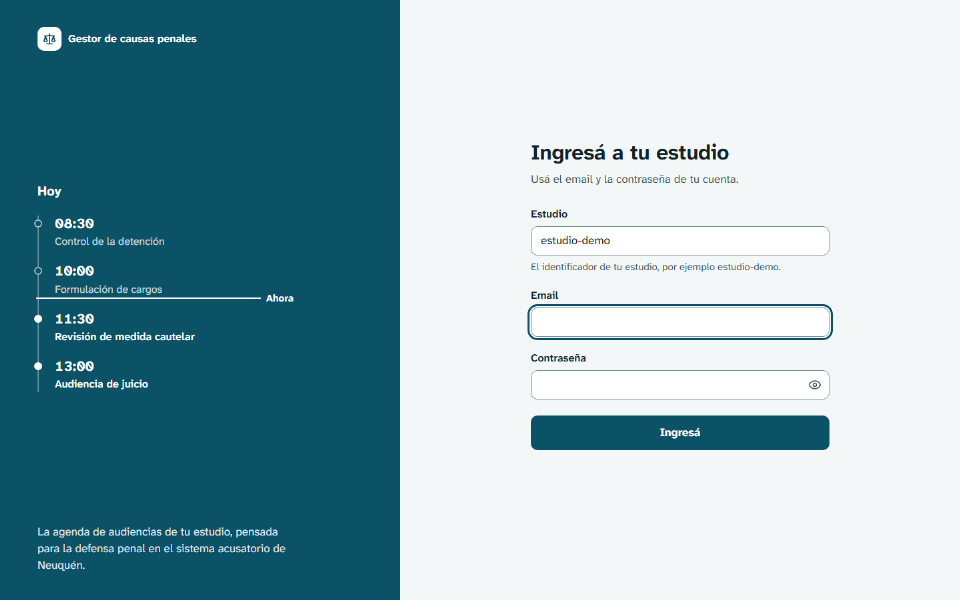
</p>

## El producto

En el sistema acusatorio el trabajo de la defensa gira alrededor de las **audiencias**, no del
expediente en papel. Por eso la pantalla principal es la agenda: qué audiencias hay hoy y esta
semana, de qué legajo, en qué sala y quién del estudio va. La demo se resume en tres frases:
"esta es tu semana de audiencias, estos son tus detenidos, esto es lo que vence".

- **Agenda de audiencias como eje:** hoy y semana, filtro por abogado, superposiciones marcadas,
  avisos de detenidos arriba de todo. Mobile-first desde 360 px, para mirarla en los pasillos de la
  OFIJU.
- **Legajos con sus imputados:** etapa, situación de libertad, defensa, medidas de coerción (art. 113)
  y salida alternativa viven en cada imputado, no en el legajo; el legajo muestra el resumen
  (etapa más atrasada, detenidos, próxima audiencia).
- **Plazos asistidos:** un motor de reglas con los plazos del CPP de Neuquén (horas corridas, días
  hábiles con feriados judiciales, días corridos, meses), prórrogas y eventos que suspenden. Cada
  vencimiento muestra la regla, el artículo y el aviso "Cálculo asistido: verificá con la norma":
  el sistema asiste, el abogado controla.
- **Configurable sin código:** catálogos de la jurisdicción que cada estudio puede renombrar, ocultar
  o ampliar; campos propios en legajos e imputados; reglas de plazos que se pueden desactivar.
  Neuquén viene de fábrica como paquete YAML versionado; otra provincia es otro paquete.
- **Importación desde CSV o Excel** de personas, legajos y audiencias, con vista previa y reporte de
  errores por fila. Todo o nada.
- **Seguridad desde el día uno:** cada estudio ve solo sus datos (multi-tenant), roles (titular,
  abogado, procurador, administrativo), sesión con CSRF, límite de intentos, segundo factor TOTP con
  códigos de recuperación, historial de cambios inalterable y **nada se borra: se archiva**.
  Los antecedentes penales son datos sensibles (Ley 25.326, art. 7) y no se cargan.

## Capturas

Las 20 pantallas de la demo, en celular y escritorio, están en
[`docs/screenshots/demo/`](docs/screenshots/demo/). Una selección:

| Celular (390 × 844) | Escritorio (1440 × 900) |
|---------------------|-------------------------|
| 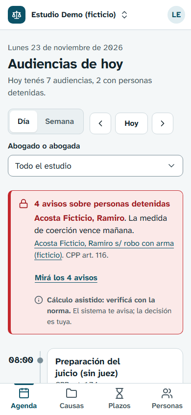 | 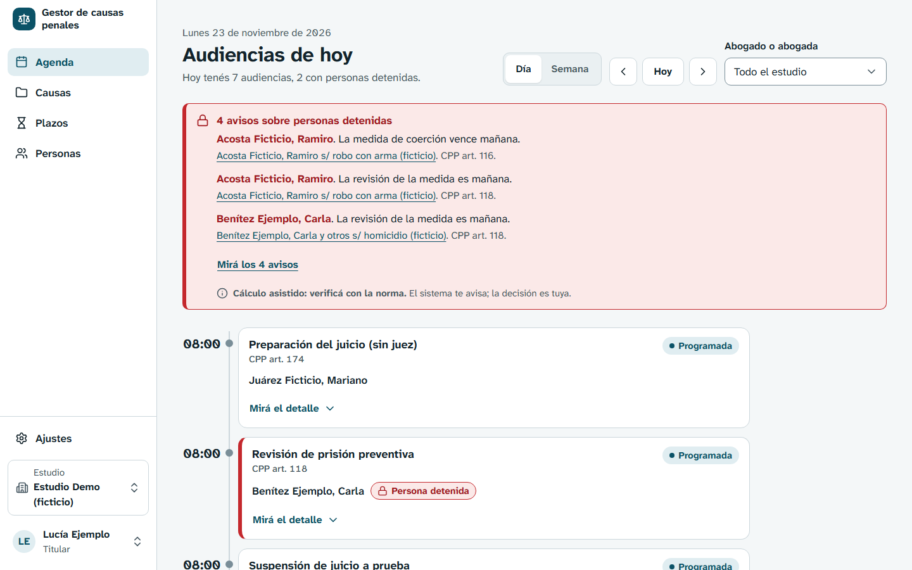 |
| 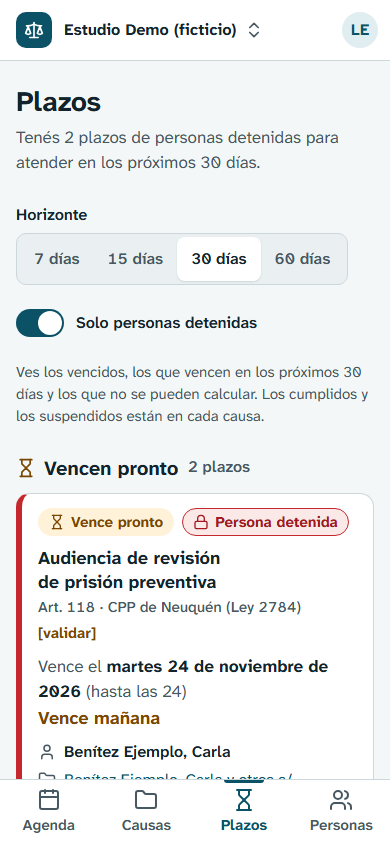 | 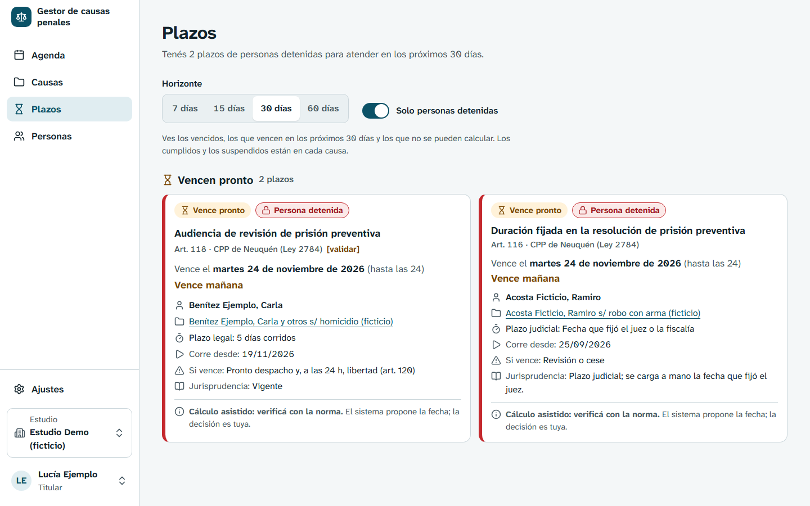 |
| 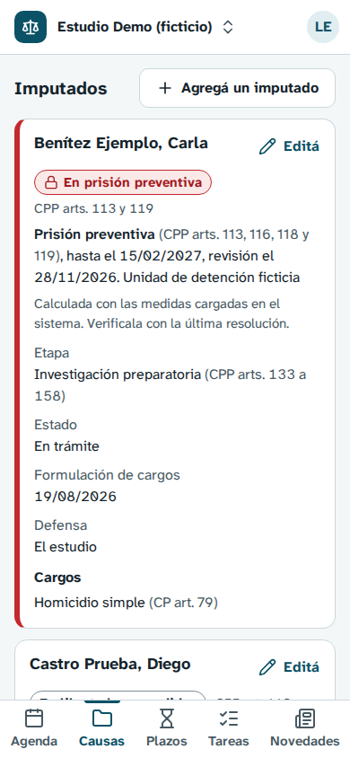 | 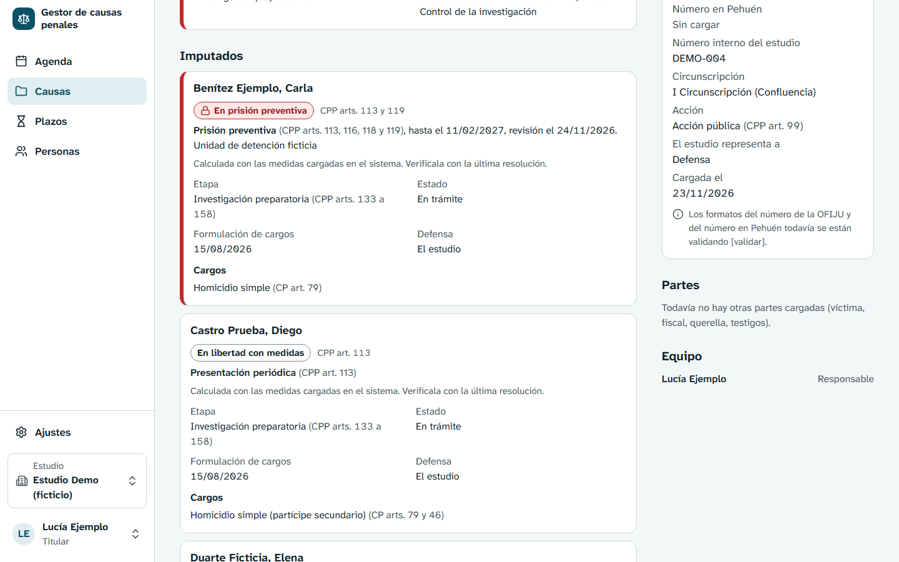 |
| 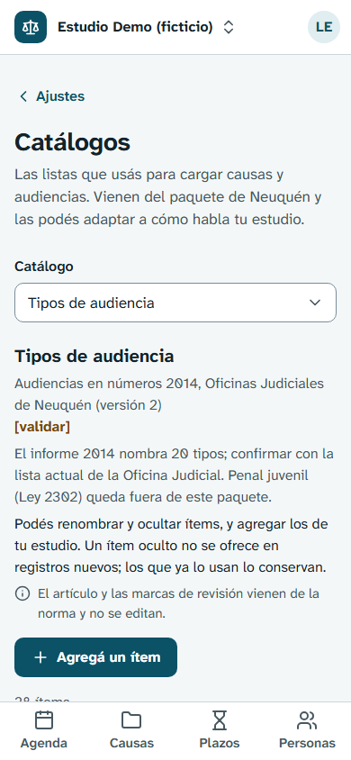 | 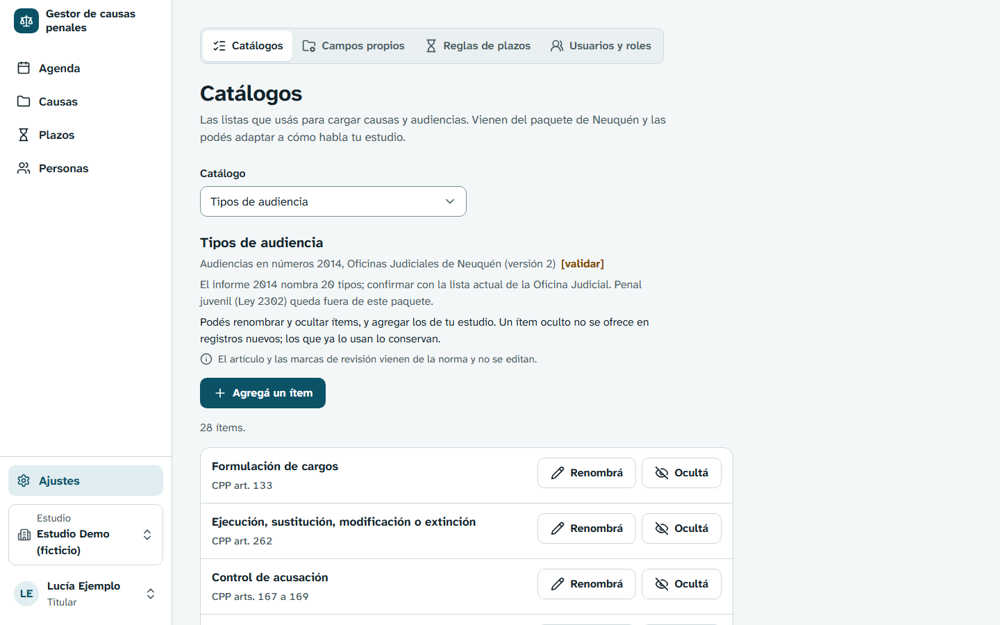 |

El GIF se arma con `npm --prefix frontend run demo:gif` a partir de las capturas de escritorio, que
salen de la demo real con `bash scripts/e2e-demo.sh --screenshots`.

## Arquitectura

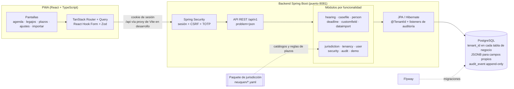

- **Monorepo:** `backend/` (Java), `frontend/` (React), `docs/` (decisiones, dominio, diseño,
  capturas), `scripts/` (demo y e2e) y `.github/` (CI).
- **Backend organizado por funcionalidad**, no por capa técnica: cada paquete (`hearing`,
  `casefile`, `deadline`...) tiene su entidad, repositorio, servicio, DTOs y controlador. Bean
  Validation en el borde y errores `application/problem+json`.
- **Multi-estudio en un esquema compartido:** todas las tablas de negocio tienen `tenant_id` y
  Hibernate agrega el filtro a cada consulta con `@TenantId`. Sin estudio resuelto, la consulta no
  devuelve nada (falla cerrada). Hay tests que prueban que el estudio A no lee al B (legajos,
  audiencias y la base) y un test de convención que falla si una tabla nueva no tiene `tenant_id`.
- **Jurisdicción como configuración:** catálogos y reglas de plazos se cargan de YAML versionado;
  lo que cambia cada estudio se guarda como filas superpuestas y el artículo de origen se conserva.
- **Motor de plazos** puro y sin base de datos: una regla + un hecho disparador + el calendario
  judicial dan un vencimiento. Los plazos de detenidos se ordenan primero.
- **Auditoría:** listeners de Hibernate escriben en `audit_event`, que triggers de PostgreSQL
  protegen contra `UPDATE`, `DELETE` y `TRUNCATE`. Borrar entidades está prohibido; se archivan.

## Stack

| Capa | Tecnologías |
|------|-------------|
| Backend | Java 21, Spring Boot 4.2, Spring Security, Spring Data JPA (Hibernate 7), Flyway, PostgreSQL 18, Apache Commons CSV y POI, Lombok, Maven |
| Frontend | React 19, TypeScript, Vite 8, Tailwind CSS v4, shadcn/ui, TanStack Router y Query, React Hook Form + Zod, vite-plugin-pwa |
| Tests | JUnit + Testcontainers (PostgreSQL real, sin mocks de la base), JaCoCo, Vitest + Testing Library, Playwright |
| Infra | Docker Compose para Postgres local, GitHub Actions |

## Cómo correrlo localmente

### Demo en un comando

Con Docker Desktop abierto, JDK 21+ y Node 22.12+:

```bash
powershell -ExecutionPolicy Bypass -File scripts\demo.ps1   # Windows
bash scripts/demo.sh                                         # Linux, macOS o Git Bash
```

Levanta Postgres, el backend con datos ficticios de hoy (base `gestor_demo`, recreada en cada
corrida) y el frontend; abre el navegador e imprime los usuarios y la clave. También publica la app
en la IP de la red local para abrirla desde un celular en el mismo Wi-Fi (`--local` / `-Local` lo
desactiva). Detalles, usuarios, guion de 10 minutos y problemas comunes en
[`docs/DEMO.md`](docs/DEMO.md). Respaldos diarios y restauración: [`docs/OPERATIONS.md`](docs/OPERATIONS.md). Publicarlo en un
hosting barato (preparado, sin deploy): [`docs/HOSTING.md`](docs/HOSTING.md).

### Paso a paso

Requisitos: JDK 21 o superior, Node 22.12 o superior, Docker con Docker Compose. Los comandos son
de bash (Linux, macOS o Git Bash). Si `./mvnw` falla en Git Bash por falta de `mktemp`, usá `mvn`
(Maven 3.10) con los mismos argumentos.

```bash
# 1. Opcional: .env solo lo lee Docker Compose; el perfil "dev" del backend ya usa los mismos
#    valores por defecto. Si cambiás DB_* acá, exportalos también para el backend.
cp .env.example .env

# 2. PostgreSQL en localhost:5434
docker compose up -d

# 3. Backend en http://localhost:8081
#    El perfil "demo" crea un estudio ficticio (slug "estudio-demo") con tres abogados y 25 legajos.
cd backend
DEMO_PASSWORD='elegí-una-clave-de-12+' ./mvnw spring-boot:run -Dspring-boot.run.profiles=dev,demo

# 4. Frontend en http://localhost:5173 (en otra terminal; /api se redirige al backend)
cd frontend
npm ci
npm run dev
```

Los usuarios de demo tienen correos `@example.com`; los nombres están en
[`DemoData.java`](backend/src/main/java/ar/gestorpenal/demo/DemoData.java). Usá Chrome o Firefox:
la cookie de sesión es `Secure` y Safari no la acepta en `http://localhost`
([ADR-0008](docs/DECISIONS.md#adr-0008-authentication-with-a-server-session-csrf-and-per-firm-users-t05)).

Los puertos 5432, 5433 y 8080 quedan libres a propósito: Postgres usa 5434, el backend 8081 y el
frontend 5173.

## Tests

| Suite | Qué cubre | Tests | Comando |
|-------|-----------|------:|---------|
| Backend | Unitarios (motor de plazos por tipo de cómputo, TOTP con vectores del RFC 6238, lectores CSV/Excel) e integración con PostgreSQL real en Testcontainers (API, aislamiento entre estudios, auditoría) | 572 | `cd backend && ./mvnw -B verify` |
| Frontend unitarios | Componentes y pantallas con Vitest + Testing Library | 311 | `cd frontend && npm test -- --run` |
| Frontend e2e | Pantallas en Chromium con el backend simulado, celular y escritorio | 20 | `cd frontend && npm run test:e2e` |
| Demo e2e | El recorrido de la demo contra el backend real con los datos ficticios: login + TOTP, agenda, legajo, plazos, importación | 6 | `bash scripts/e2e-demo.sh` |

Cobertura de líneas del backend con JaCoCo (unitarios + integración): **97,0 %** (5005 de 5161
líneas), medida el 23/11/2026. El informe queda en `backend/target/site/jacoco/index.html` después de `verify`; en
CI el porcentaje aparece en el resumen del job y el informe completo se sube como artefacto
(`backend-coverage`). Las cuatro suites corren en cada PR.

## Decisiones técnicas

Cada decisión importante tiene un ADR en [docs/DECISIONS.md](docs/DECISIONS.md) (30 en total). Las principales:

| Decisión | Por qué | ADR |
|----------|---------|-----|
| Multi-tenancy con `@TenantId` de Hibernate en esquema compartido | No se puede olvidar el filtro (cubre `findById`) y falla cerrado; RLS de PostgreSQL queda como defensa adicional futura | [0007](docs/DECISIONS.md#adr-0007-multi-tenancy-with-hibernate-tenantid-t04) |
| Sesión de servidor con CSRF, no JWT | Las sesiones se pueden revocar (un celular robado, un procurador que se va) | [0008](docs/DECISIONS.md#adr-0008-authentication-with-a-server-session-csrf-and-per-firm-users-t05) |
| TOTP propio sobre el JDK, secretos cifrados con AES-256-GCM | Funciona con cualquier app autenticadora, sin SMS ni servicios externos | [0009](docs/DECISIONS.md#adr-0009-two-factor-authentication-with-totp-and-recovery-codes-t06) |
| Auditoría genérica con listeners de Hibernate y tabla append-only | Una sola tabla en lugar de una por entidad y conoce al usuario logueado | [0010](docs/DECISIONS.md#adr-0010-change-history-with-hibernate-event-listeners-archive-instead-of-delete-t07) |
| Jurisdicción como YAML versionado y cambios del estudio como filas superpuestas | Otra provincia se agrega sin programar y el artículo de origen nunca se pierde | [0013](docs/DECISIONS.md#adr-0013-jurisdiction-packages-as-versioned-yaml-firm-changes-as-overlay-rows-t10) |
| Etapa, libertad y salida en cada imputado, no en el legajo | En un legajo con varios imputados cada uno avanza a su ritmo | [0015](docs/DECISIONS.md#adr-0015-case-file-defendants-parties-and-team-t12) |
| Reglas de plazos fijas en código, con fuente y aviso | El estudio puede desactivar una regla, no cambiar la norma; cada vencimiento dice de dónde sale | [0017](docs/DECISIONS.md#adr-0017-deadline-rule-engine-t14) |
| Campos propios como definiciones por estudio y valores JSONB | Flexibles sin migraciones y validados contra su definición | [0018](docs/DECISIONS.md#adr-0018-custom-fields-as-per-firm-definitions-and-jsonb-values-t15) |
| Importación por los mismos servicios, todo o nada | Las reglas de negocio y la auditoría valen igual que en la carga manual | [0019](docs/DECISIONS.md#adr-0019-csvexcel-import-through-the-regular-services-all-or-nothing-t16) |
| Demo en un comando con acceso desde la red local | Mostrarlo a un abogado desde el celular sin desplegar nada | [0029](docs/DECISIONS.md#adr-0029-one-command-local-demo-and-lan-access-t31) |

## Cómo se construyó

Este repositorio se programó con un flujo autónomo de agentes de IA, con una persona que define el
producto y revisa los PRs, pero que no está en el circuito mientras corre una tarea.

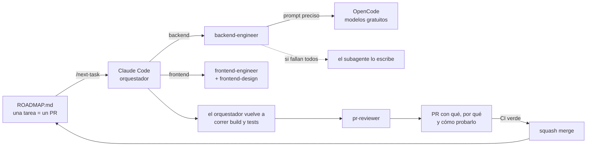

- **El ROADMAP es la cola de trabajo.** Cada tarea dice su dueño y de qué depende; el orquestador
  toma la primera lista, crea la rama, planifica, delega, verifica, pide revisión, abre el PR, espera
  la CI y mergea. Son 40 PRs para llegar al prototipo: uno por tarea, más los de proceso.
- **No confiar en el "todo pasa" de otro modelo.** Las reglas del proyecto
  ([`CLAUDE.md`](CLAUDE.md)) obligan al orquestador a correr de nuevo el build y los tests y leer la
  salida antes de cada PR. Los modelos gratuitos a veces se cortan a mitad de tarea o dicen que
  compila sin haber compilado.
- **Escalado por dificultad:** OpenCode con modelos gratuitos primero; si fallan, el subagente
  escribe el código; arquitectura, seguridad, multi-tenancy y el motor de plazos los resolvió el
  orquestador con el modelo más capaz.
- **Compuertas humanas donde hacen falta:** la investigación de dominio (catálogos y plazos del CPP)
  se revisó antes de modelarla (`gate:domain`), y la dirección visual se eligió entre tres
  propuestas con razones escritas antes de construir pantallas (`gate:design`).
- **Permisos acotados:** corre sin preguntar, pero solo con los comandos permitidos en
  `.claude/settings.json`: no puede pushear a `main`, forzar pushes ni editar sus propios permisos.
- **Memoria del proceso:** cada decisión queda como ADR y cada error que se puede repetir queda como
  una línea en "Lessons" de `CLAUDE.md`, que el agente lee al empezar cada tarea.

Detalle y puesta en marcha en [docs/AUTOPILOT.md](docs/AUTOPILOT.md); cambios por versión en
[CHANGELOG.md](CHANGELOG.md).

Las reglas de dominio marcadas `[validar]` son supuestos pendientes de confirmar con un abogado.
