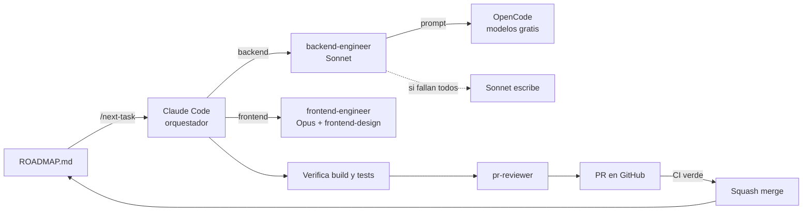

# Piloto automático: cómo se construye este proyecto

Este repositorio se programa solo: Claude Code orquesta, OpenCode escribe el backend con
modelos gratuitos, Claude escribe el frontend, y cada tarea termina en un PR revisado,
con CI en verde y mergeado. Esta guía es para el dueño del proyecto (Windows + VS Code).

## Cómo funciona



- **ROADMAP.md** es la cola de tareas. Una tarea = un PR.
- **Compuertas humanas:** `gate:domain` (investigación legal revisada) y `gate:design`
  (dirección visual aprobada). El piloto se detiene ahí y te espera.
- **Permisos:** corre con `--permission-mode dontAsk`: lo que no está en la lista de
  `.claude/settings.json` se rechaza en vez de preguntarte. No puede tocar `main`
  directamente, forzar pushes ni editar su propia configuración de permisos.

## Puesta en marcha (una sola vez)

En PowerShell, **sin** abrirlo como administrador:

1. Verificá las herramientas:
   ```powershell
   claude --version; opencode --version; gh --version; docker --version; java -version; node -v
   ```
   Si falta `gh`: `winget install GitHub.cli`. Si falta OpenCode: `npm i -g opencode-ai`.
2. Iniciá sesión en GitHub CLI: `gh auth login` (GitHub.com, HTTPS, login con navegador).
3. Confirmá que **no** existe `ANTHROPIC_API_KEY`: `echo $env:ANTHROPIC_API_KEY` debe
   mostrar una línea vacía.
4. Abrí Docker Desktop (los tests usan Testcontainers).
5. En `E:\Gestor-causas-penales`: `git pull`, abrí VS Code (`code .`) y corré `claude`
   una vez en la terminal para aceptar la confianza de la carpeta. Adentro:
   `/plugin install frontend-design@claude-plugins-official` y salí con `/exit`.

## Arrancar

Una tarea, mirando lo que hace (recomendado la primera vez):

```powershell
claude "/next-task"
```

Varias tareas seguidas, sin preguntas:

```powershell
powershell -ExecutionPolicy Bypass -File scripts\autopilot.ps1 -MaxTasks 5
```

Se detiene solo cuando no hay tareas listas, cuando una queda bloqueada (abre un PR en
borrador explicando por qué) o cuando se agota el uso de tu suscripción. Los logs quedan en
`.agent-logs\`.

## Qué revisar vos

- Los PRs en GitHub: cada uno explica qué, por qué y cómo probarlo.
- Abrir las compuertas: cuando la investigación legal esté revisada, poné
  `status: reviewed` en los archivos de `docs/domain/`; cuando apruebes el diseño, creá
  `docs/design/DESIGN.md` con `status: approved`.
- Para apagar el merge automático: `AUTO_MERGE=false` en `CLAUDE.md`.
