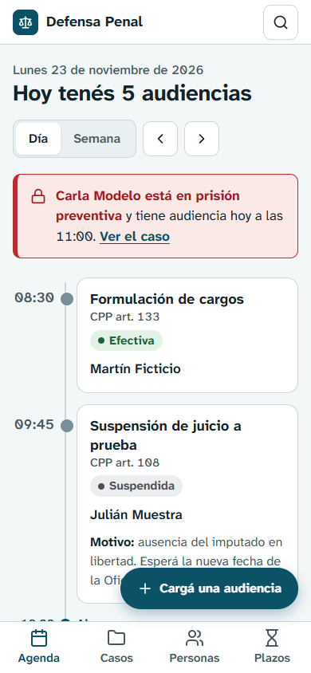
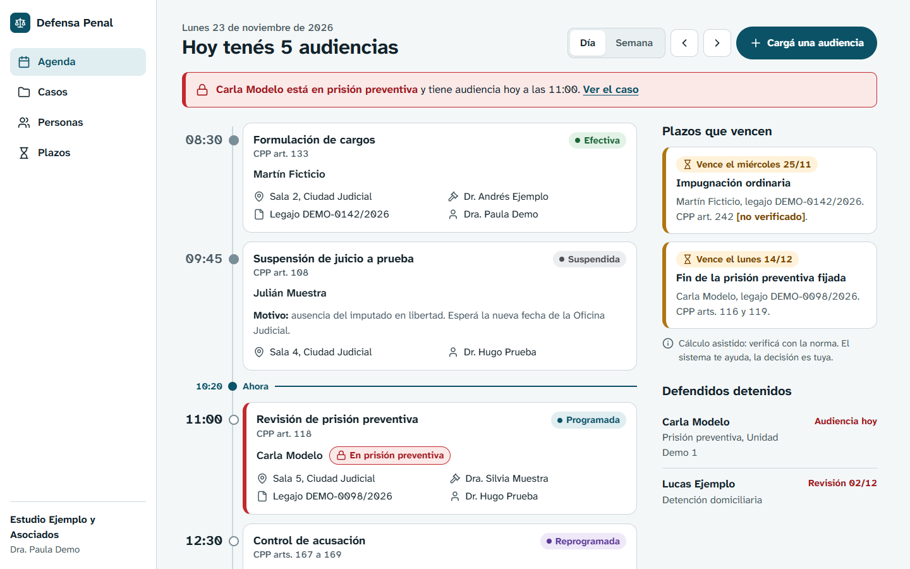
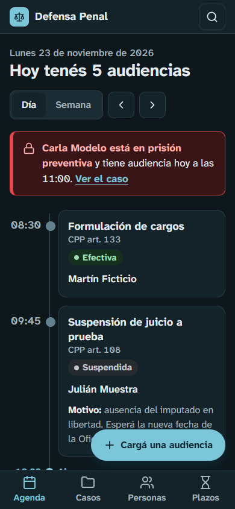
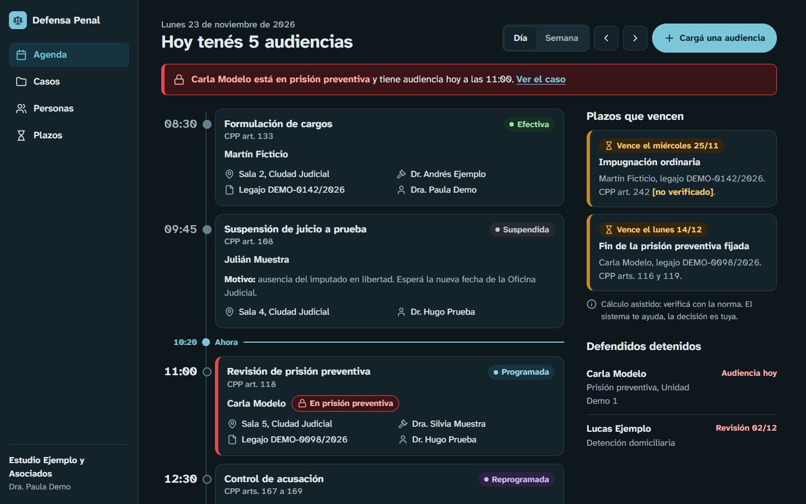
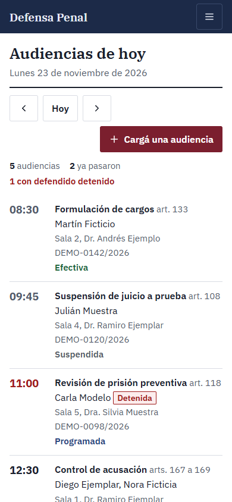
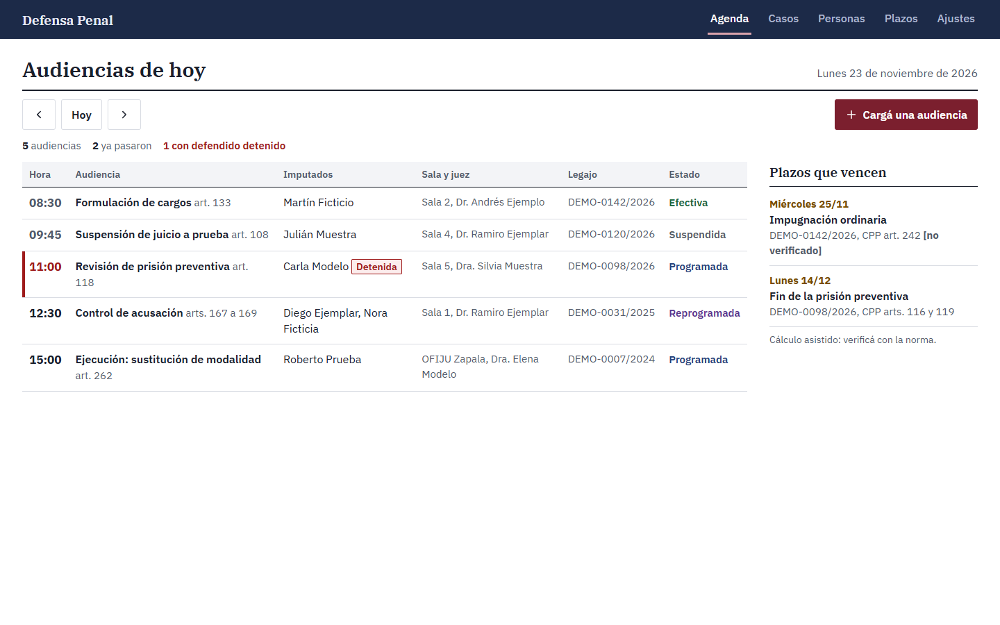
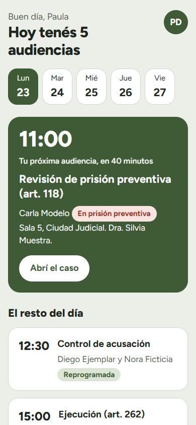
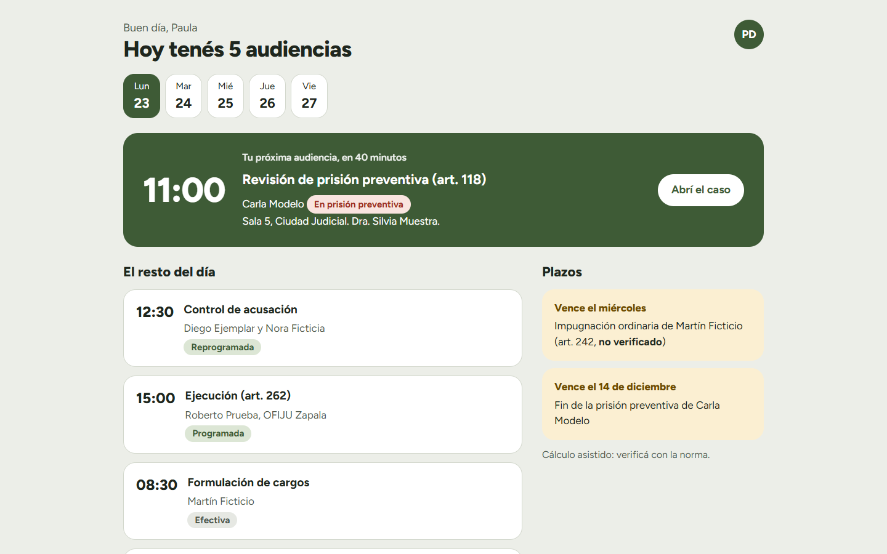

# Design direction

This is the visual spec of the product. T20 turns it into Tailwind v4 tokens and shadcn/ui
themes; every screen after that follows it. When a screen needs something this file does not
cover, extend the tokens here first, then use them.

## The brief, in one line

A hearing agenda for criminal-defense lawyers in Neuquén, aged 25 to 75, who check it on the
phone between hearings. It handles people's liberty: it must feel **serious, calm and fast**,
be readable without glasses by a 70-year-old lawyer and not look dated to a 30-year-old one.

## References

Reviewed from what Clio, MyCase, Filevine and Smokeball show on their public product pages.
Nothing is copied; these are the patterns worth keeping or avoiding:

- **Clio / MyCase**: a calm blue as the single brand color, white surfaces, a left sidebar on
  desktop and a calendar as the home. Good: one quiet accent. Weak: small 13–14 px text and
  dense gray tables that tire older eyes.
- **Filevine**: dark navigation chrome and dense project boards. Good: strong hierarchy.
  Weak: built for paralegal power users, not for a phone in a court hallway.
- **Smokeball**: matter-first, desktop-first. Weak fit: our core is the day, not the file.

What none of them do and we need: the **detained client** as a first-class alert, the
**legal source** next to every hearing type and deadline, and a phone layout that is the main
one, not a shrunken desktop.

## Three directions explored

Static mockups of "Audiencias de hoy" with fictitious data, in `docs/design/mockups/`
(open `index.html`). Same content in all three: five hearings with CPP article, room, judge,
legajo, lawyer and OFIJU status, one client in pre-trial detention, two upcoming deadlines with
the "Cálculo asistido" disclaimer.

| | A. Limay (chosen) | B. Toga | C. Estepa |
|---|---|---|---|
| Idea | Day rail: hours on a vertical line with a "now" marker, one card per hearing | Court docket: a dense table, institutional chrome | Friendly: a big "next hearing" panel, a week strip, large cards |
| Palette | Deep river blue `#0B5267` on cool paper `#F4F7F8` | Navy chrome `#1C2A48`, oxblood `#7B1F2E` | Olive `#3E5B36` on sage stone `#ECEEE8` |
| Type | Atkinson Hyperlegible Next, 17 px body | IBM Plex Sans + Plex Serif, 16 px body | Figtree, 18 px body |
| Radius | 10–14 px | 2–3 px | 18–24 px |
| Mobile density (390×844, first screen) | Alert + 2 hearings (past ones collapsed) | 3–4 hearings, but as plain text rows | 1 hearing in full + 1 card |

### A. Limay (chosen)

Dark mode of the same mockup (`prefers-color-scheme: dark`):

### B. Toga

### C. Estepa

## Why A

1. **Legibility.** Atkinson Hyperlegible Next was designed by the Braille Institute for
   low-vision readers: open counters and letterforms made to tell apart easily confused
   characters such as `I l 1` and `5 S`; in the mockup screenshots its zero also renders clearly
   distinct from `O`. That matters for legajo numbers like `DEMO-0098/2026` and for times.
   Body is 17 px, nothing below 15 px (navigation labels included). B's Plex is crisp but its 16 px body with 14–15 px secondary text in a table is the
   Clio problem again. C reads well (18 px) but spends that size on very little content.
2. **AA contrast, measured** with `node scripts/contrast.mjs` (plain Node, WCAG 2.x relative
   luminance; it prints the full table for every token pair below, light and dark, and exits
   with an error if one fails). Every text pair in A is above 6:1, so even the muted text has
   margin over the 4.5:1 minimum:

   | Pair (light) | Ratio | Pair (dark) | Ratio |
   |---|---|---|---|
   | foreground on background | 14.97 | foreground on background | 15.17 |
   | foreground on card | 16.12 | foreground on card | 13.59 |
   | muted-foreground on card | 7.39 | muted-foreground on card | 7.60 |
   | muted-foreground on background | 6.87 | muted-foreground on background | 8.48 |
   | primary-foreground on primary | 8.69 | primary-foreground on primary | 8.59 |
   | accent-foreground on accent | 7.26 | accent-foreground on accent | 8.15 |
   | detained on detained-soft | 6.60 | detained on detained-soft | 9.47 |
   | deadline on deadline-soft | 7.01 | deadline on deadline-soft | 9.48 |
   | status badges (4 states) | 6.19 to 7.26 | status badges (4 states) | 8.15 to 9.04 |
   | border-strong (rail dots, UI) on card | 3.41 | border-strong on card | 3.87 |
   | detained-edge (UI) on card | 5.69 | detained-edge on card | 4.16 |
   | deadline-edge (UI) on card | 3.86 | deadline-edge on card | 5.53 |

   B and C also pass AA (B muted 6.92, C muted on background 5.88, C primary on soft 5.93), so
   contrast did not decide alone; A has the widest margins in both themes and is the only one
   mocked and measured in dark mode.
3. **Density on mobile.** A shows the date, the count ("Hoy tenés 5 audiencias"), the
   detainee alert and two hearings in the first screen; hearings that already happened collapse
   to title, status and defendant, so later in the day the upcoming ones move up. (In the
   mockup it is 10:20 and the two collapsed ones are on top; the app should scroll the rail to
   the "Ahora" line on load.) B fits more rows but loses structure on the phone (each row
   is five loose lines with no grouping). C shows one hearing and a week strip: lovely for a
   lawyer with two hearings a week, too slow for one with six a day.
4. **Brand seriousness.** A is sober without looking like a 2005 law-firm site: one cool blue,
   no decoration, red reserved for liberty. B's oxblood and serif read "traditional firm" and the
   navy masthead feels like a court system, not a tool of the defense. C's greeting, avatar and
   rounded pills read as a consumer wellness app; for something that handles prison terms it
   feels light.
5. **It encodes the domain.** The rail makes the day a sequence (it is one), the "Ahora" line
   answers "what's next" at a glance, and the red edge plus "En prisión preventiva" badge make a
   detained client impossible to miss without shouting.

Kept from the others: B's compact table becomes the **desktop week view and list screens**
(cases, persons) using the A tokens; C's "next hearing" idea can become an optional summary at
the top of the day on mobile later.

## Tokens

Hex values below are the source of truth; T20 may write them as `oklch()` in `index.css`, as
long as the rendered color is the same. Names follow shadcn/ui; the product-specific ones are
added next to them and exposed to Tailwind with `@theme inline` (`bg-detained-soft`,
`text-status-efectiva`...).

### Color: light (`:root`)

| Token | Hex | Use |
|---|---|---|
| `--background` | `#F4F7F8` | Page |
| `--foreground` | `#13232B` | Body text, headings |
| `--card` / `--popover` | `#FFFFFF` | Cards, sheets, menus |
| `--card-foreground` / `--popover-foreground` | `#13232B` | |
| `--primary` | `#0B5267` | Main action, links, current nav item, "Ahora" line, focus ring |
| `--primary-hover` | `#08404F` | Hover/pressed of primary |
| `--primary-foreground` | `#FFFFFF` | Text on primary |
| `--secondary` | `#EAF0F2` | Segmented control track, secondary buttons |
| `--secondary-foreground` | `#13232B` | |
| `--muted` | `#EAF0F2` | Subtle fills |
| `--muted-foreground` | `#475862` | Secondary text, metadata, CPP article |
| `--accent` | `#E0EDF1` | Hover/selected rows, active nav background |
| `--accent-foreground` | `#0B5267` | |
| `--destructive` | `#A3191E` | Rare: we archive, we do not delete |
| `--destructive-foreground` | `#FFFFFF` | |
| `--border` / `--input` | `#CCD7DC` | Card borders, dividers, inputs |
| `--border-strong` | `#7A8E98` | Rail dots, input borders that must pass 3:1 |
| `--ring` | `#0B5267` | Focus outline |
| `--detained` | `#A3191E` | Text of the detainee alert and badge |
| `--detained-soft` | `#FBE9E8` | Background of the detainee alert and badge |
| `--detained-edge` | `#C4282D` | 6 px left edge of a hearing with a detained client |
| `--deadline` | `#7A4600` | Deadline date text |
| `--deadline-soft` | `#FFF2D9` | Deadline badge background |
| `--deadline-edge` | `#B07612` | 6 px left edge of a deadline card |
| `--status-programada` / `-soft` | `#0B5267` / `#E0EDF1` | Solicitada, programada |
| `--status-reprogramada` / `-soft` | `#5B3A96` / `#EEE8F8` | Reprogramada |
| `--status-efectiva` / `-soft` | `#1B6436` / `#E2F2E7` | Efectiva (realizada), reconvertida |
| `--status-suspendida` / `-soft` | `#4C4F55` / `#ECEDEF` | Suspendida, cancelada |
| `--sidebar` | `#FFFFFF` | Desktop sidebar background |
| `--sidebar-foreground` | `#13232B` | |
| `--sidebar-primary` / `-foreground` | `#0B5267` / `#FFFFFF` | Brand mark |
| `--sidebar-accent` / `-foreground` | `#E0EDF1` / `#0B5267` | Current nav item |
| `--sidebar-border` | `#CCD7DC` | |
| `--sidebar-ring` | `#0B5267` | |
| `--chart-1` … `--chart-5` | `#0B5267`, `#B07612`, `#5B3A96`, `#1B6436`, `#7A8E98` | Charts (no red: it is reserved) |

"Cuarto intermedio" (continuation) is recorded by the OFIJU as a **result** of a hearing that
did take place, not as a scheduling status [validar]. Show it as a result next to the status,
with `status-reprogramada` colors until a lawyer confirms how they read it.

### Color: dark (`.dark`)

| Token | Hex |
|---|---|
| `--background` | `#0D171C` |
| `--foreground` | `#E4ECEF` |
| `--card` / `--popover` | `#142229` |
| `--card-foreground` / `--popover-foreground` | `#E4ECEF` |
| `--primary` | `#7CC6DA` |
| `--primary-hover` | `#9AD5E5` |
| `--primary-foreground` | `#08222B` |
| `--secondary` / `--muted` | `#1B2C34` |
| `--secondary-foreground` | `#E4ECEF` |
| `--muted-foreground` | `#A3B4BC` |
| `--accent` | `#16343F` |
| `--accent-foreground` | `#9AD5E5` |
| `--destructive` / `--destructive-foreground` | `#FF8A84` / `#2A0A0B` |
| `--border` / `--input` | `#2A3D46` |
| `--border-strong` | `#62808D` |
| `--ring` | `#7CC6DA` |
| `--detained` / `-soft` / `-edge` | `#FFB3AE` / `#3A1517` / `#E5484D` |
| `--deadline` / `-soft` / `-edge` | `#F5C979` / `#33260F` / `#C98A1B` |
| `--status-programada` / `-soft` | `#9AD5E5` / `#16343F` |
| `--status-reprogramada` / `-soft` | `#CDB8F5` / `#2C2342` |
| `--status-efectiva` / `-soft` | `#9FDCB2` / `#16301F` |
| `--status-suspendida` / `-soft` | `#C5C9CF` / `#262B30` |
| `--sidebar` | `#142229` |
| `--sidebar-foreground` | `#E4ECEF` |
| `--sidebar-primary` / `-foreground` | `#7CC6DA` / `#08222B` |
| `--sidebar-accent` / `-foreground` | `#16343F` / `#9AD5E5` |
| `--sidebar-border` | `#2A3D46` |
| `--sidebar-ring` | `#7CC6DA` |
| `--chart-1` … `--chart-5` | `#7CC6DA`, `#F5C979`, `#CDB8F5`, `#9FDCB2`, `#A3B4BC` |

### Dark mode wiring (Tailwind v4)

- Declare the variant in `index.css`: `@custom-variant dark (&:where(.dark, .dark *));`
- Put the dark values under `.dark { ... }` (shadcn layout), not under a media query, so the
  user can override the system.
- A small theme provider sets `.dark` on `<html>`: from the user's saved choice ("Claro",
  "Oscuro", "Según el sistema"), and for "Según el sistema" from
  `matchMedia("(prefers-color-scheme: dark)")`, listening to its `change` event. Apply it in an
  inline script in `index.html` before first paint to avoid a light flash.
- The mockup uses `@media (prefers-color-scheme: dark)` only because it is a static file.

### Contrast check

`node scripts/contrast.mjs` measures every text pair (≥ 4.5:1) and non-text pair (≥ 3:1:
`border-strong`, edges, ring, charts) of both themes; all pass today. Keep its `TOKENS` in sync
with these tables. **T20 adds a token-contrast test** (Vitest) that reads the values from
`frontend/src/index.css` and checks the same pairs, so a token change cannot drop below AA.

Rules: red (`detained`) means **a client is deprived of liberty** and nothing else; errors in
forms use `destructive` text with an icon and a message, never a red page. Amber means **a
deadline**. Color is never the only signal: every status has its word, every alert its icon.

### Typography

- **Family:** Atkinson Hyperlegible Next (variable, 200–800), self-hosted through Fontsource
  in the app (T20 checks the package name and latest version), Google Fonts only in mockups.
  Fallback: `system-ui, -apple-system, "Segoe UI", sans-serif`. One family for everything;
  hierarchy comes from size and weight.
- **Figures:** `font-variant-numeric: tabular-nums` on times, dates and legajo numbers so
  columns align. Do not swap in another face for numbers.
- **Scale** (mobile / desktop ≥ 768 px):

  | Token | Size / line-height | Weight | Use |
  |---|---|---|---|
  | `text-display` | 28 / 34 px, 32 / 38 px | 700 | Screen title ("Hoy tenés 5 audiencias"), letter-spacing −0.01em |
  | `text-title` | 20 / 26 px | 700 | Section titles ("Plazos que vencen") |
  | `text-time` | 18 px, 21 px | 700 | Hearing time on the rail |
  | `text-card-title` | 18 / 24 px | 700 | Hearing type |
  | `text-body` | 17 / 25 px | 400–600 | Body, names |
  | `text-meta` | 16 / 24 px | 400 | Room, judge, legajo, lawyer |
  | `text-small` | 15 / 22 px | 500–700 | Badges, CPP article, disclaimers, bottom-nav labels. **Minimum size in the app; nothing goes below it.** |

- Sentence case everywhere. No all-caps labels, no letter-spaced eyebrows.
- Line length ≤ 75 characters for running text (notes, disclaimers).

### Spacing

4 px base, Tailwind's default scale. The ones in use:

- Page gutter: 16 px (mobile), 32 px (tablet), 40 px (desktop).
- Card padding: 14–16 px vertical, 16 px horizontal.
- Gap between hearings: 14 px; between sections: 28 px (mobile), 40 px (desktop columns).
- Inside a card: 10 px between blocks, 4 px between metadata rows.
- Desktop layout: 248 px sidebar, content max 1180 px, right column 340 px from 1100 px.

### Radius

`--radius: 0.625rem` (10 px), the shadcn default, kept:

- `rounded-md` 8 px: segmented items, small controls.
- `rounded-lg` 10 px: buttons, inputs, alerts.
- `rounded-xl` 14 px: cards (hearings, deadlines).
- `rounded-full`: status badges and the mobile floating action button only.

### Elevation

Flat by default: cards use a 1 px `--border`, no shadow. Shadow only for things that float
above content: the mobile floating button (`0 6px 16px` primary at 32 %), menus, sheets and
dialogs (shadcn defaults).

### Touch and focus

- Every interactive target ≥ 44×44 px; the bottom-nav items are 64 px high, the floating
  button 52 px.
- Focus: 3 px `--ring` outline, 2 px offset, on every interactive element (`:focus-visible`).
- Mobile: bottom navigation (Agenda, Casos, Personas, Plazos), main action as a labeled
  floating button ("Cargá una audiencia"), never an icon-only "+".
- Desktop (≥ 1100 px): left sidebar with the same four items plus the firm and user at the
  bottom; the main action sits in the screen header.

## Iconography

- **lucide-react** (the shadcn/ui default), stroke 2, round caps.
- Sizes: 20 px inline with text, 18 px in metadata rows, 24 px in the bottom nav, 16 px inside
  badges.
- Icons always go with a word, except universally known controls with an `aria-label`
  (search, previous/next day, close). Decorative icons get `aria-hidden="true"`.
- Fixed meanings: `Calendar` agenda, `Folder` cases, `Users` persons, `Hourglass` deadlines,
  `MapPin` room, `Gavel` judge, `FileText` legajo, `User` lawyer, `Lock` detained client,
  `Info` assisted-calculation disclaimer, `Plus` create, `Scale` brand mark.

## Motion

- Motion explains a change, it does not decorate. Durations 120–200 ms, `ease-out`; nothing
  loops; no entrance animations on page load.
- Allowed: sheet/dialog open and close, accordion expand (a collapsed past hearing), toast in
  and out, the "Ahora" line moving between slots, a status badge cross-fade when it changes.
- With Motion, wrap the app in `<MotionConfig reducedMotion="user">`; in CSS, a global
  `@media (prefers-reduced-motion: reduce)` sets transitions and animations to none. With
  reduced motion, state changes are instant.

## Tone of voice

Rioplatense Spanish, "vos", plain and respectful. The product talks like a careful colleague,
not like a marketing page or a court ruling.

- Actions in imperative "vos": **Cargá una audiencia**, **Guardá**, **Archivá el caso**,
  **Verificá con la norma**, **Abrí el caso**. The same verb names the action and its result:
  "Guardá" → "Guardado".
- Facts first, then what to do: "Carla Modelo está en prisión preventiva y tiene audiencia hoy
  a las 11:00. Ver el caso".
- Counts in second person: "Hoy tenés 5 audiencias", "No tenés audiencias hoy".
- Empty states invite an action: "Todavía no cargaste audiencias para esta semana. Cargá la
  primera".
- Errors say what happened and how to fix it, without apologizing: "No pudimos guardar la
  audiencia porque el horario se superpone con la de las 11:00 en la Sala 5. Elegí otro horario
  o confirmá la superposición".
- Deadlines always carry their legal source and **"Cálculo asistido: verificá con la norma"**.
- Use OFIJU's words for statuses (solicitada, programada, reprogramada, efectiva, suspendida,
  cancelada) and results (reconvertida, cuarto intermedio [validar]), and the CPP article as
  "CPP art. 118" / "CPP arts. 167 a 169".
- When a rule's source is not verified yet, say so on screen next to the article: "CPP art. 242
  [no verificado]", as in the mockup's "Impugnación ordinaria" deadline.
- Never: "¡Ups!", emojis, exclamation marks, "Enviar" (say what it does), legalese the lawyer
  would not use in a hallway, or casual jokes about detention.

## Do and don't

| Do | Don't |
|---|---|
| Keep body text at 17 px and nothing under 15 px | Shrink text to fit more on a phone; collapse instead |
| Use red only for a detained client | Use red for validation errors, archive buttons or "urgent" marketing |
| Show the CPP article next to the hearing type and deadline | Show a deadline without its source and the disclaimer |
| Pair every color signal with a word and an icon | Rely on a colored dot alone |
| Put the day first: time, type, defendant, room | Lead with the case number |
| Collapse what already happened | Hide hearings: a suspended one stays visible with its reason |
| Use one card per hearing with a 1 px border | Stack shadows, gradients or colored backgrounds on cards |
| Use the labeled floating button on mobile | Use icon-only primary actions |
| Use tabular figures for times and numbers | Use a monospace font for data |
| Use fictitious, obviously fake names in demos | Use names, DNIs or case numbers that could belong to a real person |

## Files

- Mockups: `docs/design/mockups/index.html`, `direction-a-limay.html` (chosen),
  `direction-b-toga.html`, `direction-c-estepa.html`.
- Screenshots: `docs/design/screenshots/direction-{a,b,c}-{mobile,desktop}.png` (390×844 and
  1440×900) and `direction-a-{mobile,desktop}-dark.png`.
- Contrast check: `scripts/contrast.mjs` (`node scripts/contrast.mjs`).
- Decision record: ADR-0020 in `docs/DECISIONS.md`.
- Implementation (T20): [COMPONENTS.md](COMPONENTS.md) maps these tokens to CSS variables and
  Tailwind classes and documents the base components; the living style guide is the app's
  `/design-system` route (ADR-0021).
